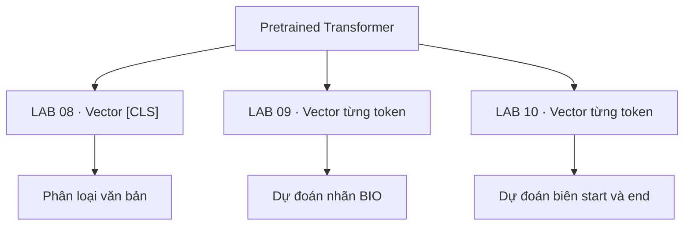

# 34. Reflection

Điểm chung của LAB 08, LAB 09 và LAB 10 là pretrained Transformer chuyển đầu vào thành một dãy vector theo ngữ cảnh. Mỗi vector đã kết hợp thông tin từ các token xung quanh. Vì backbone cung cấp biểu diễn ở từng vị trí, lớp dự đoán có thể đọc một vector đại diện cho cả văn bản hoặc xử lý từng vector, tùy vào dạng đầu ra của bài toán.

Trong LAB 08, mỗi văn bản có một nhãn. Mô hình dùng vector `[CLS]` để tính điểm cho các lớp, rồi tối ưu cross-entropy theo nhãn của cả văn bản. Sang LAB 09, một câu có thể chứa nhiều thực thể. Mô hình dùng chung một lớp tuyến tính trên các vector token để dự đoán nhãn BIO, chẳng hạn `B-PER` hoặc `I-PER`. Vì nhãn gốc gắn với từ còn BERT làm việc ở mức subword, cần căn chỉnh nhãn và bỏ qua các vị trí không được giám sát.

Trong LAB 10, đầu vào gồm câu hỏi và ngữ cảnh. Head dự đoán hai điểm tại mỗi vị trí, một cho biên đầu và một cho biên cuối. Hai nhãn huấn luyện là chỉ số token được suy ra từ offset ký tự của đáp án. Loss là trung bình hai cross-entropy. Khi suy luận, hệ thống ghép một cặp biên hợp lệ rồi dùng offset để cắt đáp án nguyên văn từ ngữ cảnh. Với ngữ cảnh dài, các cửa sổ chồng lấn giúp giữ trọn đáp án gần điểm cắt.

Điều em rút ra rõ nhất là chọn đúng vùng chứa đáp án vẫn có thể chưa đủ. Trong lần chạy Lab 10, mô hình trả “George B. Storer in 1944” trong khi câu hỏi chỉ cần “George B. Storer”. EM bằng 0 vì span thừa phần thời gian, còn F1 bằng 0,75 vì ba token tên người vẫn khớp. Trong NER, lỗi tương tự làm sai biên thực thể. Trong classification, đầu ra chỉ là một nhãn nên cách kiểm tra khác hẳn. Qua ba lab, em hiểu vì sao khi dùng lại backbone, cần thiết kế đồng thời head, nhãn huấn luyện và tiêu chí đánh giá theo đơn vị đầu ra.
